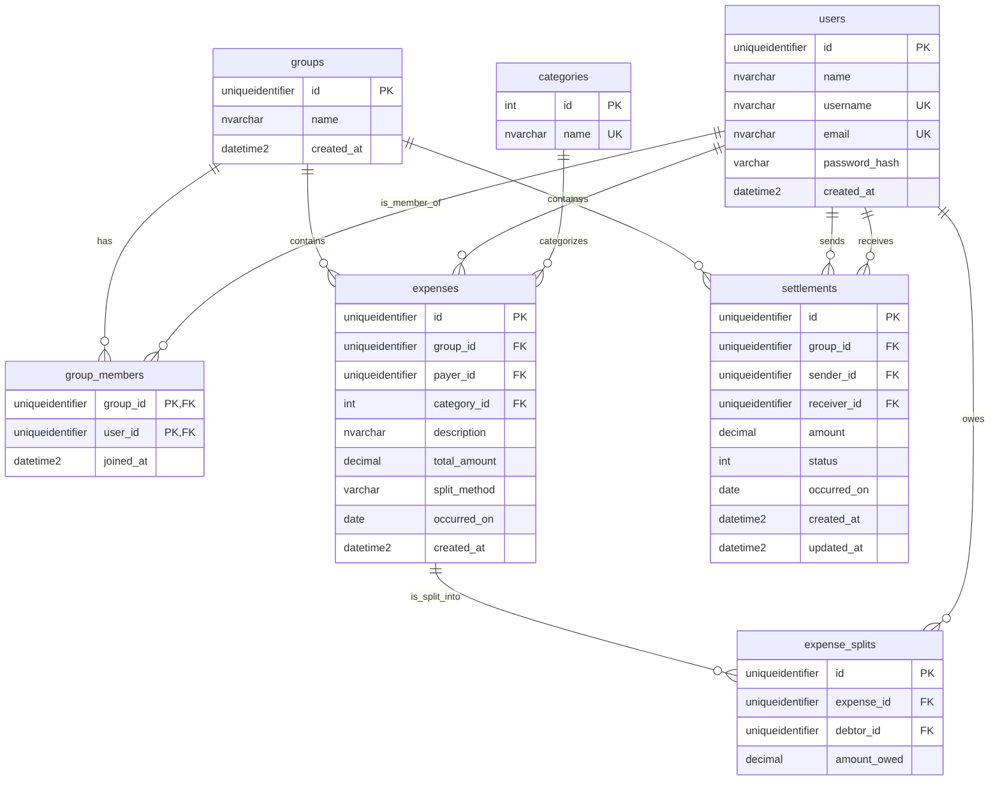

# Initial database schema

Implemented by [Alembic revision 20261107_01](../backend/migrations/versions/20261107_01_initial_schema.py).
The generated SQL Server creation script is [schema.sql](schema.sql).

All columns are non-null. UUIDs come from Python; timestamps default to UTC.
Applications must explicitly update `settlements.updated_at` when changing a row.

- Money uses `decimal(19,2)`: totals/repayments must be positive; shares may be zero.
- Membership is keyed by `(group_id, user_id)`; each expense/debtor split is unique.
  A settlement's sender and receiver must differ.
- Category IDs are fixed reference keys: `1 = Jedzenie`, `2 = Transport`, `3 = Inne`.
- Foreign keys prevent deleting referenced rows. Membership eligibility and shares
  adding up to the total are not enforced by the database.
- `split_method` and settlement `status` have no database enum constraints yet.

See [db/schema.py](../backend/db/schema.py) for exact column definitions.
