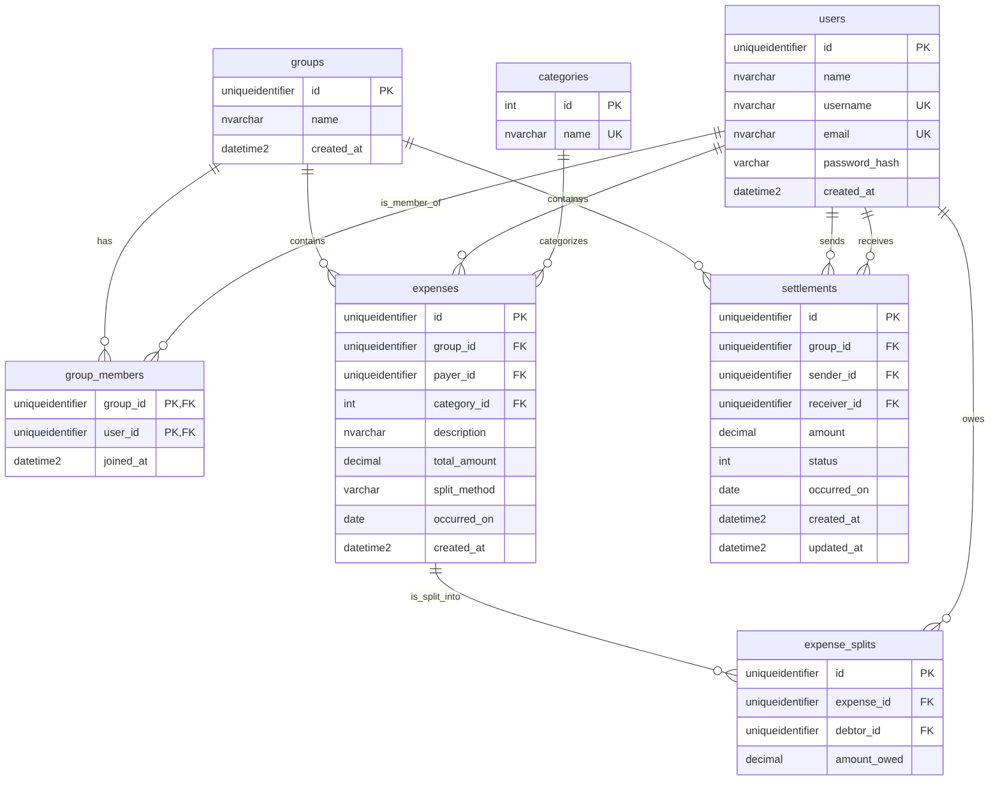

# Initial database schema

Implemented by [Alembic revision 20261107_01](../backend/migrations/versions/20261107_01_initial_schema.py).
The generated SQL Server creation script is [schema.sql](schema.sql).

All columns are non-null. UUIDs are supplied by Python; timestamps default to
`SYSUTCDATETIME()` (UTC). SQL Server `timestamp` is a row version, so actual times
use `datetime2`. Updating a settlement must explicitly update `updated_at`.

- Names/usernames/category names: `nvarchar(100)`; email: `nvarchar(254)`;
  expense description: `nvarchar(500)`; password hash: `varchar(255)`;
  split method: `varchar(20)`.
- Amounts use `decimal(19,2)`. Expense totals and settlements must be positive;
  individual shares may be zero (rounding very small expenses).
- Membership has a composite `(group_id, user_id)` primary key. A split is unique
  per `(expense_id, debtor_id)`. Settlements must have different sender/receiver.
- Category IDs are explicit reference keys, not identity-generated values:
  `1 = Jedzenie`, `2 = Transport`, `3 = Inne`.
- Foreign keys use SQL Server's default no-action behavior. Cross-row rules,
  including group membership and shares summing to the total, belong to future
  application functionality. `split_method` and settlement `status` have no
  database enumeration yet; the demo uses `equal` and status `0`.

This task implements the existing seven-table design from issue #8/#15.
Correction records, authentication, balance calculation, and HTTP database access
remain separate application tasks; this schema does not claim to implement all
proposed requirements in issue #11.
